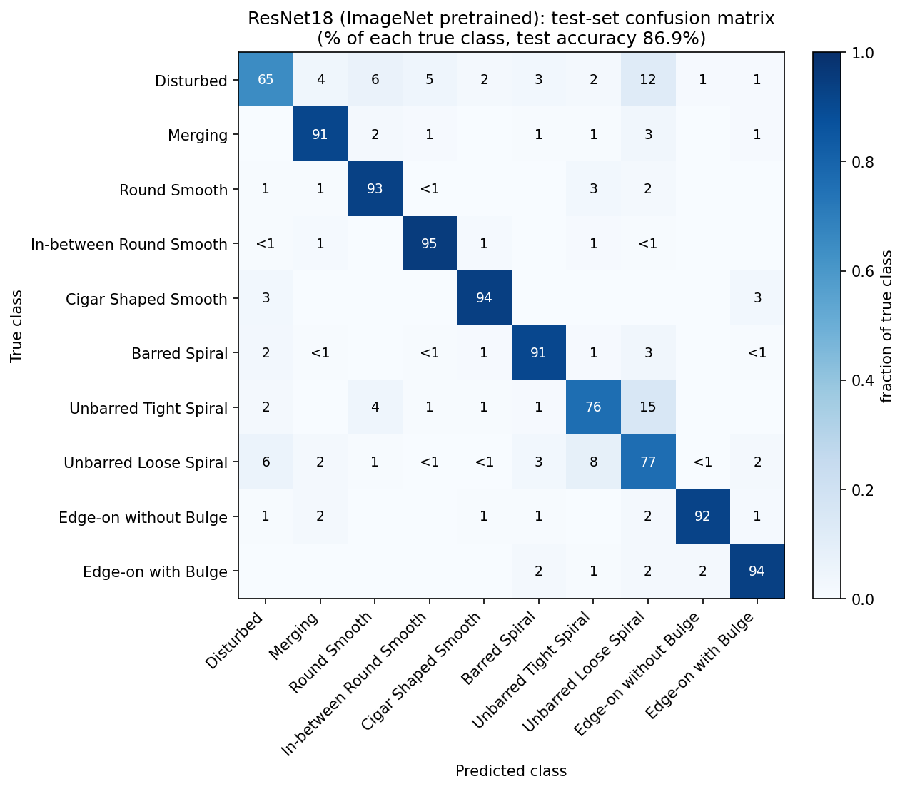

# Galaxy Classification with CNNs

Comparing a small CNN trained from scratch, a ResNet18 trained from scratch, and an ImageNet-pretrained ResNet18 on the **Galaxy10 DECaLS** dataset, to measure how much model size and transfer learning help when classifying galaxy shapes.


---

## Introduction

Modern sky surveys photograph far more galaxies than humans could ever label by eye. A galaxy's **morphology** (whether it is a smooth ellipse, a spiral, a merger, or seen edge-on) tells astronomers about its formation history, so classifying morphology automatically is a core problem in astronomy.

In this project we consider how much better a standard deep network is (ResNet18, 11.2M parameters) than a compact CNN designed from scratch (SimpleCNN, 0.39M parameters). 

We also test **transfer learning**: starting ResNet18 from weights learned on everyday photos (ImageNet) instead of random ones. Pretraining costs nothing extra at training time, but it can greatly change how well a network does when, as here, the labelled data is limited.


We train all three models on the same data split, compare them on a held-out test set, use McNemar's test to check whether the differences are statistically significant, and analyse which galaxy classes each model gets wrong.

## Key Results

| Model | Parameters | Input | Val accuracy | Test accuracy | Test balanced acc. | Test macro F1 |
|---|---|---|---|---|---|---|
| SimpleCNN | 0.39M | 140×140 | 81.4% | 80.4% | 78.2% | 78.2% |
| ResNet18 (random init) | 11.2M | 224×224 | 86.8% | 84.3% | 82.7% | 82.5% |
| ResNet18 (ImageNet pretrained) | 11.2M | 224×224 | **88.5%** | **86.9%** | **86.7%** | **86.1%** |

For reference, random guessing scores 10%, and always predicting the most common class ("Round Smooth") scores 14.9%. The test set has 1,768 images.

**Are the differences real?** McNemar's test on the test set (see [McNemar's test](#mcnemars-test-compare_modelspy-evaluate_testpy)), with a Bonferroni-corrected threshold of p < 0.0167 for three comparisons:

| Comparison (A vs B) | What it tests | Only A right | Only B right | p-value | Significant? |
|---|---|---|---|---|---|
| SimpleCNN vs ResNet18 (random init) | small custom CNN vs standard deep network, both from scratch | 70 | 139 | 2.1 × 10⁻⁶ | yes |
| ResNet18 (random init) vs ResNet18 (pretrained) | effect of pretraining alone (same network, same training) | 70 | 117 | 7.3 × 10⁻⁴ | yes |
| SimpleCNN vs ResNet18 (pretrained) | both steps together | 71 | 187 | 3.2 × 10⁻¹³ | yes |

**Takeaways**

- **Each step up is a real improvement.** ResNet18 beats SimpleCNN even without pretraining, and pretraining improves ResNet18 further. All three differences are statistically significant.
- **A bigger network helps, but less than its size suggests.** ResNet18 from scratch has about 29× more parameters than SimpleCNN, and is 3.9 points more accurate (4.5 points of balanced accuracy). This comparison changes more than the network: ResNet18 also uses a larger input (224 vs 140 pixels) and its own hyperparameters, so the gain is for the whole recipe, not for parameter count alone.
- **Pretraining adds a similar gain at no extra cost.** Starting from ImageNet weights adds another 2.6 points of accuracy and 4.0 points of balanced accuracy, with the same network and the same training. It also makes training faster: the pretrained model reaches 77% validation accuracy after one epoch, versus 65% from random weights. Features learned from everyday photos clearly carry over to galaxies.
- **Pretraining helps most on the hardest, rarest classes.** Recall on "Disturbed" rises from 43% to 65%, and on "Cigar Shaped Smooth" from 85% to 94% (see [What the errors tell us](#what-the-errors-tell-us)).
- **The hardest class is "Disturbed"** (recall 32–65% depending on the model), followed by the two **unbarred spiral** classes, which are often mistaken for each other.

<!-- TODO: add a figure here, e.g. the confusion matrix of the best model or training curves -->


## Background

### The dataset: Galaxy10 DECaLS

Galaxy10 DECaLS contains colour (g, r, z band) images of galaxies from the DESI Legacy Imaging Surveys, labelled by citizen scientists in [Galaxy Zoo](https://www.zooniverse.org/projects/zookeeper/galaxy-zoo/). We use the version with duplicate images removed: **17,675 images**, 256×256 pixels, in 10 classes.

| # | Class | Images |
|---|---|---|
| 0 | Disturbed | 1,081 |
| 1 | Merging | 1,853 |
| 2 | Round Smooth | 2,640 |
| 3 | In-between Round Smooth | 2,021 |
| 4 | Cigar Shaped Smooth | 333 |
| 5 | Barred Spiral | 2,040 |
| 6 | Unbarred Tight Spiral | 1,823 |
| 7 | Unbarred Loose Spiral | 2,600 |
| 8 | Edge-on without Bulge | 1,419 |
| 9 | Edge-on with Bulge | 1,865 |

The classes are **imbalanced**: there are 8× more Round Smooth galaxies than Cigar Shaped ones. Because of this, we report balanced accuracy and macro F1 alongside plain accuracy.

The data is split **80 / 10 / 10** into train (14,139), validation (1,768) and test (1,768) sets. The split is **stratified**, so every set has the same class proportions, and uses a fixed seed (42), so it is identical every time.


### The models

**SimpleCNN** is a compact network built from scratch. It has four convolutional blocks (Conv 3×3 → BatchNorm → ReLU → MaxPool). Each block halves the image size and doubles the number of channels (32 → 64 → 128 → 256). The blocks are followed by global average pooling, dropout (0.3) and a linear layer with 10 outputs. It has 391k parameters.

**ResNet18** ([He et al., 2016](https://arxiv.org/abs/1512.03385)) is a standard 18-layer network. Its *residual connections* let it be much deeper than SimpleCNN while still training well. We replace its final 1000-class ImageNet layer with a 10-class layer. It has 11.2M parameters.

**Transfer learning.** The pretrained ResNet18 starts from weights learned on ImageNet, which contains 1.2M everyday photos. The first layers of any image network learn generic features such as edges, gradients and textures, so we expect these to be useful for galaxies too. We **fine-tune** all layers rather than freezing them, because galaxy images are very different from ImageNet photos. To make it a fair comparison, the random-init ResNet18 is trained in exactly the same way: same preprocessing, same normalisation and same hyperparameters. Only the starting weights differ.

### Training setup

| | SimpleCNN | ResNet18 (both versions) |
|---|---|---|
| Input size | 140×140 | 224×224 |
| Normalisation | scaled to [-1, 1] | ImageNet mean / std |
| Optimiser | AdamW, lr 1e-3, weight decay 1e-4 | AdamW, lr 1e-4, weight decay 1e-4 |
| LR schedule | cosine annealing | cosine annealing |
| Batch size | 64 | 32 |
| Epochs | 60 | 30 |

All models share the following:

- **Preprocessing:** center-crop to 140×140, which removes empty sky around the galaxy. SimpleCNN uses the crop as it is; for ResNet18 it is resized to 224×224, which is the size the network was designed for.
- **Augmentation (training only):** random horizontal and vertical flips and random rotations up to 180°. Galaxies have no natural "up" direction in the sky, so a rotated galaxy is still a valid example of its class.
- **Loss:** cross-entropy.
- **Checkpointing:** the weights from the epoch with the best validation accuracy are kept.
- **Seed:** 42. The seed fixes the initial weights, the order of the training batches and the random augmentations, so a rerun gives (almost) the same model. GPU computations on Apple Silicon are not perfectly deterministic, so reruns can differ very slightly.

**Why 60 epochs for SimpleCNN and 30 for ResNet18?** ResNet18 is about 29× larger and works on bigger images, so each epoch takes much longer. 30 epochs is enough for it: the pretrained model's validation accuracy is 88.4% at epoch 21 and 88.5% at epoch 30. SimpleCNN is cheap to train but learns more slowly (higher learning rate, no pretrained features, and its training accuracy is still only about 81% at the end), so it gets 60 epochs.

Training ran on an Apple Silicon GPU (PyTorch MPS backend).
<!-- TODO: add approximate training time per model -->

## Installation

Requires Python 3.9+.

```bash
git clone git@github.com:MartinaTebar/Cool-ML-Astrophysics-Project.git
cd Cool-ML-Astrophysics-Project
python -m venv venv
source venv/bin/activate        # Windows: venv\Scripts\activate
pip install -r requirements.txt
```

**Get the data.** Download [Galaxy10_DECals_NoDuplicated.h5](https://zenodo.org/records/10845026 ) (~2.5 GB) and place it in `data/`.


## Quick Start

Run every command from the **repository root**.

**1. Prepare the data** (run once). This creates the stratified train/val/test split and saves it to `data/splits/` as `.npy` files.

```bash
python src/prepare_data.py
```

**2. Train the models.** Each command saves its best checkpoint to `checkpoints/` and a training log to `logs/`.

```bash
python src/train_simple.py          | tee logs/simplecnn.txt
python src/train_resnet.py          | tee logs/resnet_pretrained.txt
python src/train_resnet.py --random | tee logs/resnet_random.txt
```

> Trained checkpoints are already included in `checkpoints/`, so you can skip this step and go straight to evaluation.

**3. Analyse the results.**

```bash
python src/diagnose.py          # per-class recall/precision + confusion matrix (validation set)
python src/compare_models.py    # McNemar test: pretrained vs random-init ResNet18 (validation set)
python src/evaluate_test.py     | tee logs/test_results.txt   # final evaluation of all three models (test set)
python src/plot_confusion.py    # confusion matrix figure for the README (reads logs/test_metrics.json)
```

Hyperparameters are set as constants at the top of each training script. `diagnose.py` analyses one checkpoint at a time; change `CKPT_PATH` at the top of the file to choose which.

## Outputs and Interpretation

### Training logs (`logs/*.txt`)

Each line shows one epoch: the learning rate, then the loss and accuracy on the training set and on the validation set. `<- saved` marks a new best validation accuracy, which is when the checkpoint is overwritten. If training accuracy keeps rising while validation accuracy stalls, the model is starting to **overfit**.

### Per-class recall and precision (`diagnose.py`)

- **Recall:** of all the real galaxies of a class, what fraction did the model catch?
- **Precision:** of all the galaxies the model *called* that class, what fraction were right?

A class with low recall is one the model often misses. This usually happens to rare or visually ambiguous classes.

### Confusion matrix

Rows are the true class and columns are the predicted class. The diagonal holds the correct answers. Large values off the diagonal show which pairs of classes the model cannot tell apart.

### McNemar's test (`compare_models.py`, `evaluate_test.py`)

All models are evaluated on the *same* images, so we compare them image by image rather than just comparing their accuracies. McNemar's test only looks at the images where the two models **disagree**. If the models were equally good, each one would win about half of those disagreements. The p-value is the probability of seeing a split at least as lopsided as the one observed if the models really were equally good. With three models we run three comparisons, so we use a Bonferroni-corrected threshold of 0.05 / 3 ≈ 0.0167.

### What the errors tell us

Per-class recall on the test set (full confusion matrices in `logs/test_results.txt`):

| Class | Test images | SimpleCNN | ResNet18 (random) | ResNet18 (pretrained) |
|---|---|---|---|---|
| Disturbed | 108 | 32.4% | 42.6% | **64.8%** |
| Merging | 186 | 81.7% | 87.6% | **91.4%** |
| Round Smooth | 264 | **94.3%** | 93.9% | 93.2% |
| In-between Round Smooth | 202 | 91.6% | **95.5%** | 95.0% |
| Cigar Shaped Smooth | 33 | 78.8% | 84.8% | **93.9%** |
| Barred Spiral | 204 | 80.4% | 88.7% | **90.7%** |
| Unbarred Tight Spiral | 182 | 70.9% | **75.8%** | **75.8%** |
| Unbarred Loose Spiral | 260 | 69.2% | 71.5% | **76.5%** |
| Edge-on without Bulge | 142 | 91.5% | **93.7%** | 92.3% |
| Edge-on with Bulge | 187 | 91.4% | 93.0% | **93.6%** |

Below you can see the confusion matrix of the best model, the pretrained ResNet18. Each row shows where the galaxies of one true class ended up, as a percentage of that class, so the diagonal is the recall from the table above:



- **"Disturbed" is the hardest class for every model.** SimpleCNN catches only a third of these galaxies and labels 28 of the 108 as *Unbarred Loose Spiral*. "Disturbed" is a catch-all for irregular galaxies, so it has no single visual signature, and it is also the class human volunteers disagree on most.
- **Tight and loose unbarred spirals get mixed up in both directions.** For the pretrained ResNet, 28 tight spirals are called loose and 22 loose spirals are called tight. How tightly the arms are wound varies continuously, so the line between the two classes is somewhat arbitrary. Both classes stay between 69% and 77% recall for all three models, so neither more parameters nor pretraining solves this. SimpleCNN has the most trouble here: it calls 36 of the 182 tight spirals loose.
- **Easy classes:** Round Smooth, In-between Round Smooth and the two edge-on classes are above 90% recall for every model, including SimpleCNN. These shapes are visually distinctive, and a small network is enough to recognise them.
- **Pretraining helps most where data is scarce or the class is ambiguous:** Disturbed (+22 points of recall compared with random init), Cigar Shaped Smooth (+9, only 267 training images), Unbarred Loose Spiral (+5) and Merging (+4). On the easy classes it makes almost no difference.

## Project Structure

```
├── src/
│   ├── prepare_data.py      # stratified train/val/test split 
│   ├── dataset.py           # PyTorch Dataset, transforms, class names
│   ├── model_simple.py      # SimpleCNN architecture
│   ├── model_resnet.py      # ResNet18 builder 
│   ├── train_simple.py      # training loop for SimpleCNN
│   ├── train_resnet.py      # training loop for ResNet18 
│   ├── diagnose.py          # error per class analysis on the validation set
│   ├── compare_models.py    # McNemar test: pretrained vs random ResNet18
│   ├── evaluate_test.py     # final test-set evaluation of all three models
│   ├── plot_confusion.py    # confusion matrix figure from logs/test_metrics.json
│   └── preview_crop.py      # visual check of the center-crop size
├── checkpoints/             # trained model weights
├── logs/                    # training logs, diagnostics, test results
├── figures/                 # figures used in this README
├── data/                    # Galaxy10_DECals_NoDuplicated.h5
└── requirements.txt
```


<!-- ## Limitations and Future Work
- **One run per model.** Each model was trained once, so we cannot say how much the scores would vary with a different random seed. Repeating each run 3–5 times would give error bars.
- **Class imbalance is not addressed.** Class weights in the loss, or oversampling of rare classes, could improve recall on Disturbed and Cigar Shaped Smooth.
- **Knowledge distillation.** A natural next step is to use the pretrained ResNet18 as a *teacher* for SimpleCNN, training the small network to match the large network's predicted probabilities. This would show how much of the big model's performance a 30× smaller model can recover. -->


## References

- Leung, H. W. & Bovy, J. — [astroNN / Galaxy10 DECaLS dataset](https://astronn.readthedocs.io/en/latest/galaxy10.html)
- Walmsley, M. et al. (2022) — [Galaxy Zoo DECaLS: detailed visual morphology measurements from volunteers and deep learning for 314,000 galaxies](https://arxiv.org/abs/2102.08414), MNRAS 509, 3966


## License

[MIT](LICENSE)

<!-- TODO: add a license (e.g. MIT) and acknowledgements if needed -->
